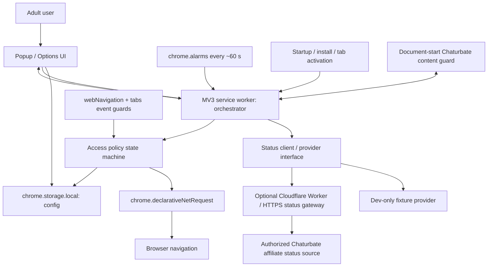

LiveLock — Product and Technical Architecture
Status: Implementation specification / Chrome MV3 MVP
Version: 1.0 draft
Date: 2026-10-22
1. Product and non-goals
Mission: A privacy-minded, user-configurable adult-content blocker that permits one chosen Chaturbate broadcaster's canonical room only when an authorized live-status source confirms the broadcaster is publicly live.
MVP user stories
Adult user manually installs LiveLock on desktop Chrome and understands its scope.
User enters or pastes one Chaturbate broadcaster username or room URL.
User enables blocking. The main Chaturbate website and configurable other adult sites remain blocked whenever protection is enabled; protection defaults to enabled.
Extension polls a reliable live-status provider and displays LIVE, OFFLINE, CHECKING, or UNKNOWN.
Only the canonical selected room becomes navigable during a verified LIVE state; all other rooms and blocked domains stay blocked.
If the broadcaster is confirmed offline, status is unknown/stale, selection changes, or user invokes Lock Now, LiveLock revokes access.
All preferences persist locally; no user accounts or browsing history are required.
Protection enable/disable contract
When config.enabled === true, deny rules are active and only an exact verified live room may be allowed. If the adult user explicitly turns protection OFF in Settings (with a prominent warning/confirmation), disable the baseline static ruleset using updateEnabledRulesets, remove custom dynamic deny rules and any live session allow rules, and show Protection OFF — LiveLock is not blocking. Re-enable the baseline before checking a new grant. This is not a tamper-proof commitment system; a more frictionful protection mode can be added later. Rule state and UI must agree across restarts and updates.
Non-goals / truthful limitations
Not a tamper-proof, system-wide filter; users can disable an extension or use another browser, device, or unprotected incognito mode.
Not a guaranteed real-time stream-end detector. Polling, stale data, sleeping devices, and delayed alarms impose lag.
Not a catalog of every adult site. MVP blocks named domains; category-scale filtering is later work.
Not a tool for discovering, scraping, embedding, recording, redistributing, or downloading explicit content.
No broadcaster thumbnails/previews, recommender feed, payments, accounts, or tracking.
The product is for adults only and does not bypass Chaturbate access restrictions or age checks.
2. API feasibility and compliance gate (must run first)
Official Chaturbate Affiliate Promo Tools list 'API - Users Online v2' and v1. Their detailed documentation is login-gated; an outsider cannot yet verify supported parameters, rate limits, pagination, completeness, access rights, or licensing for this product. See https://chaturbate.com/affiliates/promotools/ and https://chaturbate.com/affiliates/promotools/api_usersonline/.
The User Statistics API at https://chaturbate.com/statsapi/documentation/ requires the broadcaster's own generated token; do not treat it as a general-purpose status endpoint.
Affiliate syndication can be opted out of by broadcasters, so absence from a listing cannot automatically prove offline. See https://support.chaturbate.com/hc/en-us/articles/22668646607252-DMCA-on-Chaturbate.
Gate 0 deliverable: docs/provider-feasibility.md must identify:
Which provider is authorized and usable; whether developer/affiliate login or contract is required.
Whether lookup by exact username is supported, whether a complete online roster can be enumerated within rate limits, and how timestamps/room availability are represented.
Whether CORS/proxy requirements or terms prohibit the proposed use.
Demonstrable sample of sanitized success, explicit offline, and unknown/error cases; no API secrets committed.
If no approved source exists, ship a functioning mock-provider / simulator extension with real blocking. Clearly label LIVE as simulated in developer builds and never present a fake status as production data. Do not quietly scrape an undocumented site endpoint or bypass access controls.
Publication: Chrome Web Store policy may reject software that directs users to adult sites; developer guidance explicitly warns about such extensions. First distribute for testing as locally loaded, unpacked code; assess Chrome Web Store eligibility separately. Source: https://developer.chrome.com/docs/webstore/troubleshooting.
3. Architecture diagram

Main trust boundary
The extension must never contain production API keys. An authorized server-side provider, if required, owns credentials and returns only minimal status metadata. The extension treats all remote data as untrusted and verifies schema, username match, freshness, and expiry before granting access. No status provider may remotely supply executable code or arbitrary allowlisted URLs.
4. Technology stack
Layer
MVP choice
Rationale
Browser
Chrome desktop, Manifest V3
Current Chrome extension architecture
Language
TypeScript, strict mode
Explicit schemas and testable policy logic
Build
Vite + minimal MV3 packaging or @crxjs/vite-plugin if confirmed compatible
Reproducible unpacked extension
UI
React + lightweight CSS (or vanilla TS if smaller)
Popup / options only, no remote assets
Rules
chrome.declarativeNetRequest
Browser-native enforcement on navigations
Background
Extension service worker
Event-driven status and rule updates
Scheduler
chrome.alarms
Works across service-worker suspension; approximate
Storage
chrome.storage.local
Local prefs, no sync of sensitive preferences
Navigation
chrome.webNavigation / chrome.tabs and content script
Address SPA changes and open tabs
Backend (conditional)
Cloudflare Worker + server-side secrets, cache, rate limits
Official feed credentials off client; shared polling
Validation
Zod or small explicit runtime validators
Defensive handling of malformed provider data
Unit tests
Vitest
State, parser, policy, rule generation
Browser tests
Playwright / Chrome extension context
Actual MV3 behavior, including startup and navigation
CI
GitHub Actions
Lint, typecheck, test, build
Never bundle credentials, cookies, broadcaster private data, remote JavaScript, or stream/video fetchers.
5. Repository organization
livelock/
├── README.md
├── LICENSE
├── package.json
├── pnpm-lock.yaml
├── tsconfig.json
├── vite.config.ts
├── public/
│   └── icons/
├── src/
│   ├── manifest.ts                 # or manifest.json
│   ├── background/
│   │   ├── index.ts                # registers listeners synchronously
│   │   ├── bootstrap.ts
│   │   ├── alarms.ts
│   │   ├── reconcile.ts
│   │   ├── status-client.ts
│   │   └── tab-guards.ts
│   ├── core/
│   │   ├── types.ts
│   │   ├── usernames.ts
│   │   ├── urls.ts
│   │   ├── status-machine.ts
│   │   ├── access-policy.ts
│   │   ├── rules.ts
│   │   └── clock.ts
│   ├── providers/
│   │   ├── interface.ts
│   │   ├── gateway-provider.ts
│   │   └── fixture-provider.dev.ts
│   ├── content/
│   │   └── room-guard.ts
│   ├── popup/
│   │   ├── index.html
│   │   └── App.tsx
│   ├── options/
│   │   ├── index.html
│   │   └── App.tsx
│   ├── rules/
│   │   └── baseline.json
│   └── blocked/
│       └── blocked.html           # optional, only if proven safe and reliable
├── worker/                         # conditional provider gateway
│   ├── src/index.ts
│   ├── src/affiliate-adapter.ts
│   ├── wrangler.jsonc
│   └── tests/
├── tests/
│   ├── unit/
│   ├── integration/
│   └── e2e/
└── docs/
    ├── provider-feasibility.md
    ├── permission-model.md
    ├── threat-model.md
    ├── test-matrix.md
    └── manual-install.md
6. Configuration and types
type Platform = 'chaturbate';
type LiveState = 'live' | 'offline' | 'unknown';
type UiState = 'unconfigured' | 'checking' | 'locked_offline' | 'locked_unknown' | 'unlocked_live';

interface UserConfig {
  schemaVersion: 1;
  enabled: boolean;
  platform: Platform;
  username: string | null;        // canonical, lowercase
  blockedDomains: string[];       // validated DNS domains, never arbitrary wildcards
  strictRoomOnly: true;            // MVP hardcoded
  notifyWhenLive: boolean;        // default false, later optional
  providerBaseUrl: string | null;  // pinned by build; do not accept arbitrary user URL in production
}

interface StatusObservation {
  platform: Platform;
  username: string;
  state: LiveState;
  observedAt: string;  // ISO8601 UTC
  validUntil: string;  // ISO8601 UTC
  source: 'authorized-affiliate' | 'fixture';
  reason?: 'unavailable' | 'not-listed' | 'access-denied' | 'stale' | 'rate-limited';
}

interface AccessGrant {
  platform: Platform;
  username: string;
  grantedAtMs: number;
  expiresAtMs: number;
  observationAtMs: number;
  configRevision: number;
}
Username input accepts a simple handle or https://(www.)chaturbate.com/<handle>/ URL, parsed using URL and exact hostname matching, then validated against a restrictive ASCII handle pattern (final length constraints to be verified). No raw string interpolation into regex filters; escape metacharacters. No arbitrary URLs in rules. Exact username identity only; unrelated routes and usernames fail closed.
chrome.storage.local keys: config, configRevision, lastObservation, grant, lastError, lastCheckedAt. No personal identifiers, browsing-history log, stream metadata, or tracking. Avoid chrome.storage.sync for selected broadcaster.
7. Access decision and state machine
UNCONFIGURED ------> LOCKED
LOCKED --poll start--> CHECKING
CHECKING --fresh, exact username, approved LIVE--> UNLOCKED_LIVE
CHECKING --confirmed OFFLINE---------------------> LOCKED_OFFLINE
CHECKING --error, stale, omitted, rate-limit----> LOCKED_UNKNOWN
UNLOCKED_LIVE --fresh LIVE refresh--------------> UNLOCKED_LIVE
UNLOCKED_LIVE --offline/unknown/failure----------> LOCKED
UNLOCKED_LIVE --user edit/disable/lock now-------> LOCKED
UNLOCKED_LIVE --grant age exceeds TTL-----------> LOCKED (on next enforcement event)
Rules:
Always package a baseline blocking ruleset independently of source availability. Keep it enabled whenever protection is ON; only an explicit user protection-OFF choice may disable it.
Grant only when status.state === 'live', username matches selected normalized name, source is approved production provider (or development fixture in explicitly marked dev build), response isn't stale, timestamps are sensible, and config revision hasn't changed.
Use a short grant lease (default maximum 90 seconds) and poll around every 60 seconds. Lease is a logical expiry, not a browser-enforced automatic DNR expiry; reconcile on every alarm, startup, popup open, browser/tab focus, URL navigation, and content-guard message.
On expiry, failure, configuration change, offline, or Unknown, remove the allow rule first, then update state and close/redirect previously open unauthorized rooms. Prevent races using a config revision/request sequence and serialize rule writes.
A provider roster omitting a username must yield UNKNOWN unless the provider contract proves authoritative coverage of that broadcaster, including opt-out semantics. Do not falsely label unknown as offline.
Do not auto-open a broadcaster's room on a LIVE event. Only permit navigation initiated by user.
Do not make silent manual override in normal MVP; a user can disable the extension at Chrome's extension-management layer, which this product cannot prevent.
Latency guarantees
Status freshness and relock are best effort. Chrome alarms can be delayed or paused on sleep. DNR session allow rules don't self-expire on a timestamp. A document-start content guard reduces exposure on new navigation but cannot prove zero-delay revocation. UI must describe this honestly.
8. Browser blocking strategy
Package an initially enabled static DNR ruleset (disable only on explicit protection-OFF action) that blocks top-level and embedded navigation to chaturbate.com and configurable baseline adult sites (Chrome's domain matcher includes subdomains), with distinct rule IDs and an explicit priority (example 100).
Dynamic DNR rules block user-configured domains using validated request-domain matches; protect site controls against accidental overrides.
When verified LIVE, add a session-scoped DNR allow rule (priority 200) for main_frame exactly matching https://chaturbate.com/<username>/ or the www host equivalent (optionally harmless query/hash variants), not all Chaturbate hosts or paths. Check isRegexSupported() and testMatchOutcome() in tests. Do not use a broad allowAllRequests rule by default.
Since baseline denial only targets main_frame/sub_frame navigations, ordinary static assets/API requests necessary for the allowed room are not globally blocked by this extension. Verify the real room renders correctly with common login and age-verification conditions. Do not whitelist the full site as a shortcut.
chrome.webNavigation.onHistoryStateUpdated, onCommitted, and tab events observe main-frame navigation; a document-start content script on Chaturbate overlays/guards unauthorized routes or expired grants, especially SPA transitions that don't trigger new network navigations. Don't assume all site navigation triggers DNR.
When relocking, proactively redirect currently open unauthorized Chaturbate tabs to a local locked page (after removing allow rule). Build a reliable blocked-page experience only after testing redirect + permissions; a browser-native ERR_BLOCKED_BY_CLIENT is acceptable for MVP.
Use an access-policy module as the source of truth. Never grant access from popup UI booleans alone.
Ensure opened tabs, reloads, direct links, mobile links, iframe embedding, www variations, path confusion, and lookalike hosts are tested.
Important scope caveats
An allowed broadcaster page may still contain recommendations, thumbnails, chat, or links inside that room, even if navigation to a different room is blocked. Optionally suppress discovery widgets with content CSS, but this is brittle. Incognito is not protected unless the user separately grants extension permission; other browsers and native apps are out of scope.
9. Provider abstraction and optional server
interface LiveStatusProvider { getStatus(platform: Platform, username: string): Promise<StatusObservation>; }
Implement two providers:
FixtureProvider (development/test only): deterministic states with fake handles, simulated timestamps and errors; excluded from production build and visibly marked.
GatewayProvider (production after Gate 0 approval): GET /v1/status?platform=chaturbate&username=... from HTTPS gateway. Validates JSON response and freshness with a short timeout; on all errors returns UNKNOWN, never LIVE.
Example successful response:
{
  "platform": "chaturbate",
  "username": "sample_handle",
  "state": "live",
  "observedAt": "2026-10-22T17:00:00Z",
  "validUntil": "2026-10-22T17:01:30Z",
  "source": "authorized-affiliate"
}
Example unavailable response: same identity, "state":"unknown", "reason":"unavailable"; client must not unlock.
If authorized affiliate integration is permitted:
Keep credentials in Cloudflare Worker secrets (never return them in responses, headers, URLs, or extension bundles).
Poll or cache feed once per shared interval server-side, not once per extension user. Build an index keyed on normalized username; distinguish known-live from missing/not-represented. Honor terms, pagination, rate limits, and opt-out.
Cache sanitized status for short intervals, add backoff and rate limits. HTTPS only. Don't persist followers' identities or browse histories. Avoid request-body logging and disable/query-minimize status access logging wherever operationally practical; disclose that requested usernames reach the gateway.
No account database, payments, authentication, model screenshots, stream fetches, or analytics needed in MVP. Production abuse controls may require limited non-identifying aggregate counters.
Don't confuse the broadcaster-authorized Events API or user statistics token with an arbitrary broadcaster live-status API.
10. Manifest/permissions
Baseline: manifest_version: 3, background.service_worker, action.default_popup, options_page or options_ui, static DNR rule_resources, icon assets, restrictive CSP, content script on https://*.chaturbate.com/* and/or canonical domain variants with run_at: document_start.
Likely permissions: declarativeNetRequest, storage, alarms, webNavigation, tabs (justify tab URL inspection, closure/re-navigation), and specific host_permissions for Chaturbate content guard plus the validated HTTPS gateway. Minimize further permissions. No cookies, history, broad webRequest, clipboard, arbitrary remote scripts, or activeTab unless shown necessary.
declarativeNetRequest supports browser-native block, allow, and session rules; priorities must be explicit. Sources: https://developer.chrome.com/docs/extensions/reference/api/declarativeNetRequest and https://developer.chrome.com/docs/extensions/reference/api/alarms.
11. UX design
Onboarding
Adult-use notice and honest limitations (Chrome only, cannot block disabled extensions / unprotected incognito).
Select Chaturbate; input broadcaster username or room URL; validate locally.
Show provider status: Live verification connected or Live verification unavailable — blocking still works.
Enable protection; default locked.
Popup
Header: LiveLock; clear protection ON/OFF status. Protection-OFF requires an explicit confirmation in Settings.
Selected handle and exact platform.
Status pill: LIVE / OFFLINE / CHECKING / UNKNOWN, timestamp of last verified check.
Large action: Open approved room only while genuinely LIVE.
Lock now, Check again with rate-limit safeguards, Settings.
Short disclosure: verification can lag; avoid encouraging use when streamer not accessible.
Settings
Edit/remove handle; explicit disable with warning; re-enable; manage blocked domains; privacy summary; manual test/status diagnostics; version and source type. No thumbnails, search/related broadcaster discovery, chat, account login, or payment prompts.
Blocked experience
Neutral page or browser-native blocked navigation: This page is restricted by LiveLock. If relevant, Selected broadcaster is not confirmed live. No adult thumbnails or promotional calls to action.
12. Security, privacy, and reliability
Input handling: parse URLs; exact chaturbate.com hostname with optional www, case normalization, strict characters; never trust URL substrings; escape regex input.
Provider: strict schema and identity equality; timeout, exponential backoff, no stale live; use clock skew tolerance; pin gateway origin; avoid open redirect/SSRF and remotely controlled allowlist URLs.
Concurrency: serialize all rule writes; stale responses cannot overwrite more recent config or a confirmed lock.
Fail closed: invalid source, network failure, unknown status, platform age gate, update, or restart all mean deny until positive re-verification.
Privacy: usernames local except when queried through gateway; no collection of visited sites, history, stream content, credentials or payment data; never log raw username unnecessarily; transparently disclose remote lookup.
Accessibility: keyboard support, labels, clear status text, no color-only state, high contrast.
Platform: do not bypass age checks or content access control; adult-only product positioning; consult current Chrome Web Store and Chaturbate terms before public distribution.
13. Development plan / checkpoints
0. Prove status-source feasibility: research/verify official source, terms and access; document truthfully; otherwise dev fixture only.
1. Real blocker first: scaffold MV3 extension, static domain rules, popup, local config, handle validation, no live unlock.
2. Policy + simulation: implement typed states, fixture provider, session allow exact room, URL guard, relock. Test with fake handles; mock URLs in unit tests and real browser navigation tests (without accessing adult streams in automated runs).
3. Production provider: implement a permitted, authenticated source server-side, short cache, failures, real test with manually supplied permitted username, no credentials committed.
4. Hardening: restarts/service-worker suspension, multi-tab, stale data, errors, SPA navigation, incognito disclosures, update migrations, manual test matrix and CI.
5. Distribution: README for chrome://extensions developer mode / Load unpacked; GitHub release; investigate (do not assume) Web Store compliance and third-party terms.
14. Minimum automated tests / acceptance checklist
Install extension unpacked; baseline Chaturbate navigation blocked while configured broadcaster offline/unknown. Explicit OFF disables all LiveLock deny rules and shows unprotected status; turning ON restores them before polling.
Enter username or room URL; normalize and save correctly; reject lookalike and malicious strings.
Dev fixture set to LIVE: exact chosen URL loads; another broadcaster, directory, and unlisted adult domain still blocked.
Dev fixture set to OFFLINE or UNKNOWN: allow session rule removed; existing allowed pages redirected/guarded.
Status response wrong identity, stale timestamp, future timestamp, server 500/429, timeouts, bad JSON, malformed payload: fail closed.
Race: input changed while request pending does not unlock former/new wrong handle.
Simulated service-worker restarts, browser restarts, alarms, Chrome tab/window focus, multiple tabs/windows reconcile grant and rules.
SPA/history URL changes to another room or directory are blocked/redirected.
Domain variations, case, query and fragments, IDN/lookalike hosts and embedded frames cannot widen allow rule.
Content guard does not permit a stale verified LIVE state after lease expires when navigated/focused.
Data stays local except transparently documented gateway username queries; no screenshots/history/payments/secrets persisted or sent.
Unit tests, E2E suite, typecheck, lint, production build run; no fake LIVE toggles in production.
Provider feasibility report and caveats in README; no production claims until actual integration works.
15. Extensibility after MVP
Once stable, introduce a PlatformAdapter registry with canonical room URL parser, domain/rule builder, and signed/verified status provider per platform. Additional features could include several chosen creators, user-configurable hours/budgets, graduated self-control friction, expanded filter lists, system-wide Mac/Windows companion, optional encrypted preference export, and multi-browser support. Never silently expand permissions or share selections with marketing services.
16. References
Chaturbate official affiliate promo tools: https://chaturbate.com/affiliates/promotools/
Affiliate users-online v2 page (login-gated): https://chaturbate.com/affiliates/promotools/api_usersonline/
Chaturbate user statistics API and broadcaster token: https://chaturbate.com/statsapi/documentation/
Broadcaster affiliate syndication opt-out: https://support.chaturbate.com/hc/en-us/articles/22668646607252-DMCA-on-Chaturbate
Chrome DNR: https://developer.chrome.com/docs/extensions/reference/api/declarativeNetRequest
Chrome alarms: https://developer.chrome.com/docs/extensions/reference/api/alarms
Chrome navigation: https://developer.chrome.com/docs/extensions/reference/api/webNavigation
Chrome Web Store policy/troubleshooting: https://developer.chrome.com/docs/webstore/troubleshooting
