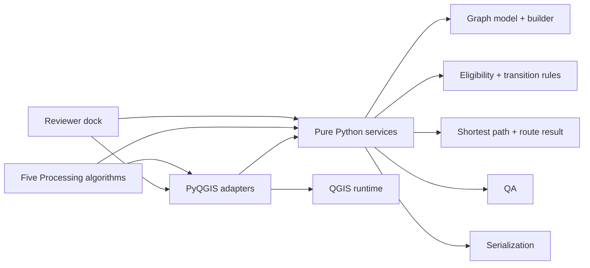

# Utility Route Lite v1 architecture

**Decision state:** frozen design contract, version `1.0.0`, 2026-10-16. The plugin shell and Network Builder now exist; the other planned services remain implementation targets. [DATA_CONTRACT.md](DATA_CONTRACT.md) defines the public bytes and fields; [ACCEPTANCE_MATRIX.md](ACCEPTANCE_MATRIX.md) defines evidence required to call an implementation conformant. The [prior-art audit](audits/PRIOR_ART.md) found that QGIS's native graph director merges coincident interior vertices, so it cannot enforce this product's connection policy. The decisions below close its architecture blockers as design choices. Unimplemented capabilities remain unverified.

## One plugin and dependency direction

The package will be `utility_route_lite/` with one `classFactory` entry. `initGui` registers one `QgsProcessingProvider` with ID `utilityroutelite`, five `QgsProcessingAlgorithm` classes, and one action opening a `QgsDockWidget` named Route Reviewer. `unload` removes the action, closes and destroys the dock, disconnects canvas signals, and unregisters the provider. Repeated load/unload must not duplicate algorithms, actions, docks or signal handlers. `metadata.txt` will declare `hasProcessingProvider=yes`, `qgisMinimumVersion=4.2`, and `qgisMaximumVersion=4.99`; no obsolete `supportsQt6` flag. Actual compatibility must be tested on QGIS 4.2+.

Module responsibilities are deliberately narrow:

| Proposed module | Responsibility and dependency rule |
| --- | --- |
| `core/model.py` | Immutable source-part, anchor, node, edge, traversal, junction, issue and provenance records. No `qgis` imports. |
| `core/builder.py` | Build physical graph from validated 2D parts. Split only at source part endpoints and **declared** interior junction anchors. No crossing noding, topology repair or source write. |
| `core/eligibility.py` | Parse versioned rule profile, evaluate edge status/direction, and authorize each incoming-to-outgoing transition. Unknown/unsupported values fail closed. |
| `core/routing.py` | `heapq` shortest eligible distance over `(node_id, incoming_traversal_id)` states; deterministic ordering and no negative weights. |
| `core/qa.py` | Policy-consistent components, dangles, undeclared crossing/interior touch, overlap, near miss, invalid source and unknown-rule issues. Inspector can report invalid source rows even when graph building must abort; component counts are marked unavailable in that case. Never transforms findings into connections. |
| `core/result.py` | Route segments, warnings, request outcome and review identity. Route geometry uses complete original 2D vertex sequences between chosen anchors. |
| `core/serialization.py` | Canonical JSON, SHA-256 IDs/digests, stable sorting, CSV/HTML escaping and result validation. Does not access user files directly. |
| `qgis_adapters/` | Read QGIS layers without edits, explicit CRS transforms, `QgsDistanceArea` measurement, conservative Z/M checks, GeoPackage writer, Processing feedback/cancellation and map highlighting. This is the only layer importing `qgis`. |
| `processing/` | One provider and the five frozen algorithm IDs/parameters. Thin translation between Processing values and services. |
| `ui/reviewer.py` | One dock. Loads a route result, highlights source segments, shows assumptions/issues, and saves review state to a user-selected sidecar. Does not mutate source layers. |

The five algorithm IDs are `utilityroutelite:build_network`, `utilityroutelite:inspect_network`, `utilityroutelite:find_route`, `utilityroutelite:batch_routes`, and `utilityroutelite:export_bundle`. Their frozen parameters and outputs are in the data contract. A graph JSON can be reused, while Inspector and Router may build a graph from a source layer in the same invocation using the same builder. Batch builds once per source snapshot/profile, then routes all pairs. Packager accepts a saved route/batch result without an open project.

## Graph and connectivity

The input is one existing line layer with a persistent, user-declared `layer_key` and a nonempty unique `source_feature_key` field. Its QGIS feature ID is retained only as an optional diagnostic. MultiLineString parts are read in their original order as separate parts. Every part preserves every original 2D vertex; invalid, empty, zero-length, repeated-vertex, curved and duplicate-key inputs fail the build with located issues. Z/M requires an explicit 2D-projection opt-in and is reported. The graph stores full part shape and derived edge intervals, never a straight endpoint chord.

Graph computation uses a declared projected `network_crs` whose horizontal unit is meters. Incoming source and junction coordinates carry declared CRSs and are transformed using QGIS transform context. Transformed coordinates must be finite. Exact graph endpoint equivalence means bitwise-equal normalized 2D IEEE-754 coordinates after transformation to `network_crs`; `-0.0` normalizes to `0.0`. There is no topology tolerance for connectivity. Conversion differences and near misses are reported by QA, not rounded into equality. This strict rule favors false disconnection over invented connection; owners can supply explicit evidence or correct authorized source data outside the plugin.

`GEOMETRIC_ENDPOINT_ONLY` coalesces exact coincident **part endpoints** into a node and permits traversal between eligible directions there. It displays `NOT_ASSET_VERIFIED` on every result. It never connects X crossings, T contacts at the interior of a part, coincident interior vertices, overlaps or points merely inside a snap tolerance. It takes no junction table. This policy makes a geometric hypothesis, including when distinct assets happen to share endpoint coordinates.

`EXPLICIT_JUNCTIONS` initially keeps each part's endpoint node distinct. Its versioned junction JSON declares a junction ID, coordinate, exact source-part anchor members, and directed transitions between members. A declared interior anchor splits its member part **virtually**, preserving all original vertices and `source_part`/fraction provenance. An anchor must lie exactly on the declared source segment in the transformed 2D graph; inconsistent anchors are rejected, never snapped. Travel straight through successive intervals of the **same source part** is intrinsic continuity, subject to direction and eligibility. Travel between different source parts occurs only through a listed, directed transition at a listed junction. A missing reverse row forbids reverse movement. Merely colocated junction records do not merge. An undeclared crossing, interior touch or endpoint coincidence remains disconnected. An overlap with no explicit anchors is separately flagged; it is not a shared edge.

Eligibility is evaluated before traversal. Each physical edge has `OPEN`, `BLOCKED` or `UNKNOWN`; direction is `FORWARD`, `REVERSE` or `BOTH`. The declared rule profile maps exact input field values into these enums. Missing fields, nulls, unmatched values, unknown constraints and unsupported rule names are errors or `UNKNOWN`, never default open. Strict mode is the only v1 mode: `BLOCKED` and `UNKNOWN` arcs are excluded, with reasons in QA/result. `EXPLICIT_JUNCTIONS` additionally requires permitted transitions. In geometric mode every eligible incoming/outgoing pair at a coalesced endpoint is permitted; a policy requiring turn restrictions must use explicit junctions. A zero-length/self-loop edge is invalid and excluded.

The router runs Dijkstra with a binary heap. The state is `(node_id, incoming_traversal_id)` because a permitted outgoing traversal can depend on arrival. Edge weights are finite, nonnegative 2D lengths in **meters**. Invalid or negative values abort; zero-length physical edges are invalid. Candidate ordering is `(total_length_m, ordered_traversal_id_sequence)` so equal-cost ties resolve by stable traversal sequence. Exact double comparisons determine ties; no hidden epsilon can overturn a shorter path. The implementation may store a compact equivalent path-order key but must prove identical ordering. Stop only when the minimum valid destination state is settled. A result contains the chosen ordered physical edge/fraction sequence, not just a polyline.

## Endpoint attachment and same-edge behavior

Request start and end have an explicit request CRS. For each eligible physical edge, find the closest point on each 2D straight segment in `network_crs`; compute the request-to-candidate offset with QGIS distance facilities in meters. Compare offsets to the declared `snap_tolerance_m` (inclusive), then sort candidates by `(offset_m, edge_id, source-segment index, segment fraction)`. If the best distance is shared by distinct edges at the same numeric offset, return `AMBIGUOUS_SNAP` unless the caller supplied that endpoint's `edge_id`. A supplied edge must be eligible and within tolerance. Snapping creates only an **ephemeral port on that edge**. It cannot join otherwise separate edges, even if their snapped coordinates coincide.

If both requests attach to one edge, split its traversal temporarily at both fractions and include the direct subedge when its direction permits. Also evaluate paths via that edge's endpoints when they can be shorter under declared transitions; choose the globally shortest eligible route. Same-fraction start/end returns `SAME_LOCATION` instead of an empty LineString. A partial edge's length is remeasured along the retained original vertex sequence between snap anchors; never multiply whole-edge length by a projected fraction when ellipsoidal measurement could differ. Request-to-network offsets are recorded separately and are never included in route geometry or `length_m`. This is a route **through existing pathways**; offsets do not represent constructed connector segments.

## CRS, dimensions, lengths and provenance

The source layer CRS, request CRS, junction CRS and output/network CRS are all explicit and validated. QGIS coordinate transformations use the supplied transform context and abort on failure, missing grids or nonfinite coordinates. Antimeridian-spanning and other ambiguous transforms fail with a clear code. The network CRS must be projected with meter horizontal units for graph geometry and snap candidate calculation. Geographic and foot-based **inputs** are supported through a validated transformation to that CRS. Length weights and snap offsets use `QgsDistanceArea` configured with the graph CRS and declared ellipsoid, converting returned length units to meters. The default ellipsoid is `WGS84`; `NONE` is an explicit planar option only and still reports meters. The method, ellipsoid and QGIS version are in provenance. No assumption equates map units with meters, and no scalar degrees-to-meters shortcut is allowed.

The supported geometry is 2D LineString/MultiLineString represented as straight segments with every source vertex retained. Curves and geometry collections are rejected instead of linearized silently. Z/M inputs are rejected unless `allow_2d_projection=true`; with that flag, the output is explicitly 2D and a `Z_M_IGNORED` issue and warning is mandatory. Depth, height and M never establish connectivity. For a route over part of an edge, output begins and ends at precise temporary anchors and includes all original intervening vertices. Reversed traversal reverses that vertex order. Adjacent route segments concatenate only where the authorized graph/transition says they meet.

The durable source identity is `(layer_key, source_feature_key, part_index)` plus a content fingerprint. The user supplies `layer_key`; the feature key field must be unique and immutable for the snapshot. `part_index` is zero-based original multipart order. Reordering parts changes the snapshot and may change edge IDs, so a saved route becomes stale. `source_snapshot_sha256` covers sorted source keys, relevant eligibility/direction values, every original coordinate ordinate including Z/M when present, and declared source CRS. No raw provider URI or credentials are exported. Node/edge IDs are deterministic SHA-256 IDs as defined in the data contract, stable for unchanged normalized inputs under the same transform/version; `graph_digest` detects any graph or profile change. A reviewer checks source and graph digests before showing a saved route as current. The plugin does not add IDs to or edit the source layer.

## Outputs, limits and failures

Builder writes a canonical, versioned `network_graph.json` plus QA issues. Router writes a result JSON and a GeoPackage with `proposed_routes` and `route_segments`. Inspector writes QA GeoPackage and summary JSON; when source validation fails, it still emits located issues and marks graph-dependent counts unavailable. Batch writes the same route layers, per-request result JSON and a failures CSV; a failed row does not abort valid rows. Reviewer writes a versioned review-state JSON sidecar. Packager produces a directory or ZIP with `utility_routes.gpkg` (`proposed_routes`, `route_segments`, `qa_issues`), `route_summary.csv`, `routing_config.json` and `report.html`. These schemas and field types are frozen in [DATA_CONTRACT.md](DATA_CONTRACT.md). HTML escapes all user-controlled text and uses no remote assets; CSV neutralizes spreadsheet formula-leading text before quoting. Path validation and staging prevent destination/source collisions and half-written bundles. No source utility layer receives a write transaction.

Validation failures return stable error codes. Expected no-route cases become result records with status `FAILED`, no fake route geometry and a reason code. A malformed graph/profile, duplicate source key, unsupported geometry or failed CRS transformation aborts the job before publishing outputs. QGIS `feedback.isCanceled()` is checked during scans, graph build, path search, batch rows and export. Cancellation removes staging artifacts and reports `CANCELED`; no partial bundle is presented as complete. Batch stages disk output by row, reuses one graph and commits successful rows plus failure records only after normal completion. Nodes, edges and issues sort by stable IDs; request records and CSV rows sort by `input_row`; successful route features sort by route ID. JSON/CSV/HTML reports have deterministic content and no wall-clock values.

The v1 guardrails are `250,000` derived physical edges, `2,000,000` retained source vertices and `100,000` batch requests. Exceeding a limit returns `LIMIT_EXCEEDED` before publishing output; these are explicit product limits, not performance promises. A graph needs O(V+E) memory; path search uses O(states + transitions) memory in the worst case. The adapter must avoid materializing all batch request results in RAM and show progress. Benchmarks and larger-network support require measured evidence before changing the limits.

## Versioning and change control

Public contract `schema_version=1.0.0` applies to graph, route, review, junction and bundle manifests. Canonical machine-readable IDs/fields/enums are in [contract/v1.json](contract/v1.json). Readers reject unknown major versions and unsupported required fields. Minor additions may add optional fields with safe defaults; existing required fields, meanings, IDs, algorithm names and status codes cannot silently change. Patches clarify behavior without changing bytes or semantics. Writers emit only the version they fully implement. A schema migration must preserve original provenance and include old/new round-trip fixtures.

Any implementer proposing a change must add a numbered entry to `docs/DECISIONS.md` explaining the conflict, affected schema/algorithm IDs, migration and acceptance tests, then obtain architect review before editing the frozen contract. The current user request authorizes this freeze; subsequent implementers must not reinterpret the prior-art findings away. The original source licenses remain subject to the import gate in the audit.
